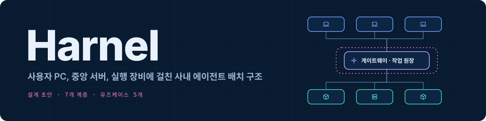
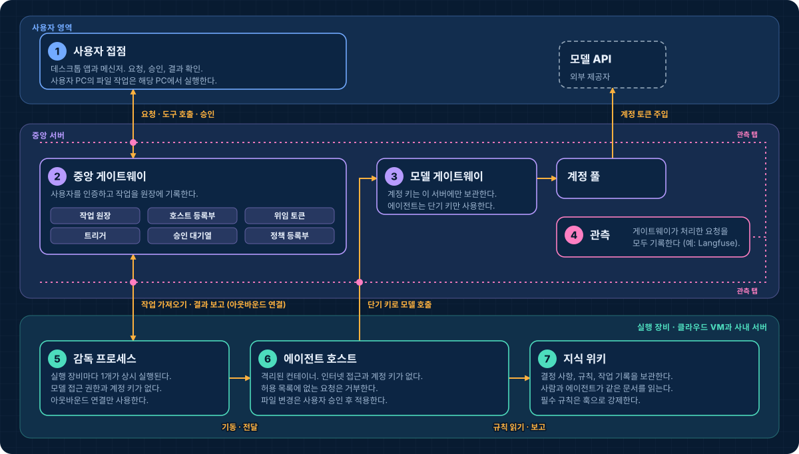
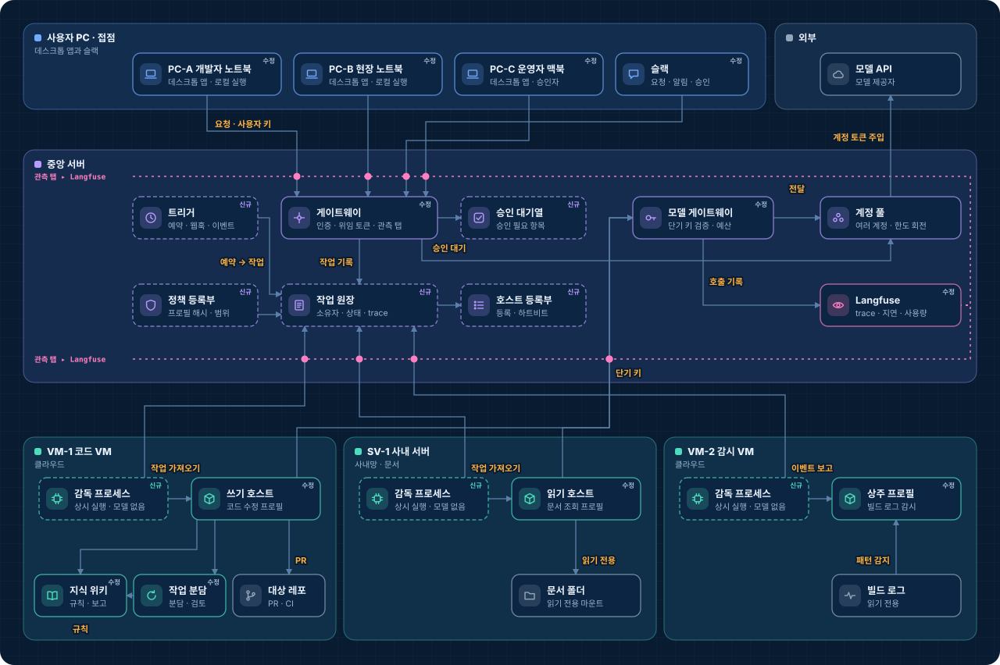
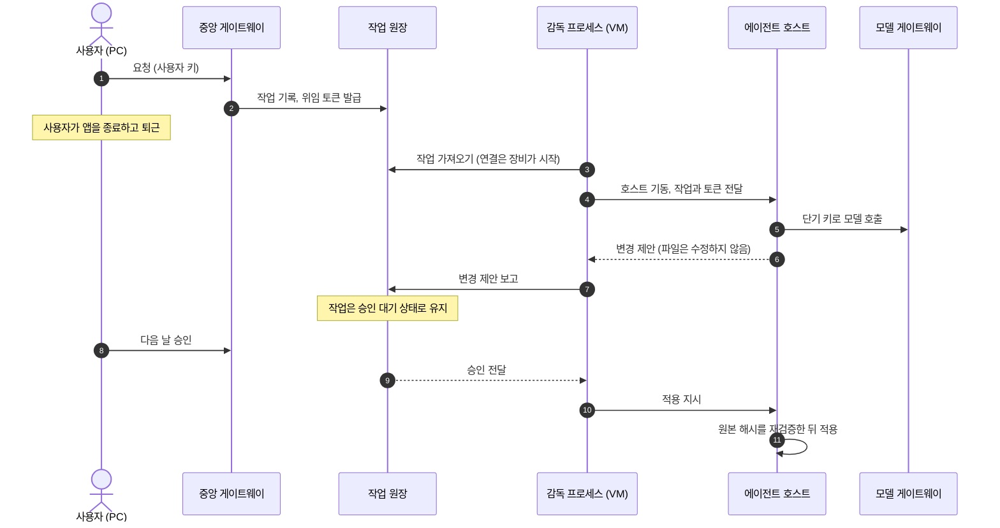

<p align="center">
  
</p>

# Harnel

Harnel(하넬)은 사내 AI 에이전트의 배치 구조에 붙인 이름입니다. 에이전트를 사용자 PC, 중앙 서버 1대, 실행 장비(클라우드 VM과 사내 서버)에 배치하고 한 곳에서 관리합니다. 이 문서에서 에이전트는 스스로 도구를 호출해 작업을 완료하는 AI 프로그램을 말합니다.

이 구조의 구성 요소는 모두 이미 제품이나 오픈소스로 존재합니다. 이 저장소는 그 구성 요소를 어떤 계층으로 나누는지, 각 계층의 책임과 책임 범위 밖이 무엇인지를 정의합니다.

> **상태** 설계 초안입니다. 이 저장소에는 실행 가능한 구현이 없습니다. 각 계층의 일부를 따로 구현해 실행해 보았고, 구조 전체를 처음부터 끝까지 구현하거나 검증하지는 않았습니다.

**[인터랙티브 배치도](https://dominic-dk.github.io/harnel/)** · [7개 계층](#7개-계층) · [유즈케이스](usecases.md) · [기존 제품과의 관계](#기존-제품과의-관계) · [English](en/README.md)

## 개요

<p align="center">
  
</p>

회사에 에이전트를 배치하면 네 가지 질문이 생깁니다. 이 작업을 누가 요청했는가, 어디서 실행되는가, 무엇까지 허용되는가, 무슨 일이 있었는지 사후에 확인할 수 있는가. Harnel은 이 질문을 7개 계층에 배정합니다.

| | 계층 | 책임 | 책임 범위 밖 |
| --- | --- | --- | --- |
| 1 | [사용자 접점](layers/01-entry.md) | 요청과 승인을 받고 결과를 표시합니다. 사용자 PC의 파일 작업은 해당 PC에서 실행합니다. | 작업 상태를 저장하지 않습니다. 앱을 종료해도 작업은 계속됩니다. |
| 2 | [중앙 게이트웨이](layers/02-gateway.md) | 사용자를 인증하고, 작업을 작업 원장에 기록하고, 실행 장비에 배정하고, 승인을 수집합니다. | 도구를 실행하지 않습니다. 실행 장비로 연결을 열지 않습니다. |
| 3 | [모델 게이트웨이](layers/03-model-gateway.md) | 모델 계정 키를 보관하고, 단기 키를 검증하고, 예산을 적용합니다. | 어떤 작업을 할지 결정하지 않습니다. |
| 4 | [관측](layers/04-observability.md) | 게이트웨이가 처리하는 모든 요청의 수락, 전달, 완료를 기록합니다. | 요청을 지연시키거나 차단하지 않습니다. 권한 판정의 기준 기록이 아닙니다. |
| 5 | [감독 프로세스](layers/05-supervisor.md) | 장비를 등록하고, 작업을 가져오고, 에이전트 호스트를 기동·종료하고, 결과를 보고합니다. | 모델을 호출하지 않습니다. 임의의 명령을 실행하지 않습니다. |
| 6 | [에이전트 호스트](layers/06-agent-host.md) | 격리된 컨테이너에서 에이전트를 실행하고, 정책을 평가하고, 쓰기 전에 실행을 중단합니다. | 인터넷에 직접 접근하지 않습니다. 계정 키를 보유하지 않습니다. |
| 7 | [지식 위키](layers/07-knowledge.md) | 결정 사항, 규칙, 작업 기록을 사람과 에이전트가 함께 읽는 문서로 보관합니다. | 실시간 상태를 보관하지 않습니다. |

## 다섯 가지 설계 결정

계층의 경계는 다섯 가지 결정에서 나옵니다. 각 결정 아래에 유사한 결정을 한 제품을 적었습니다. 2026년 11월 공개 문서 기준입니다.

**1. 작업의 소유자는 앱이 아니라 작업 원장입니다.**
사용자 PC가 실행 주체이면 앱을 종료할 때 작업이 중단됩니다. 그래서 모든 요청을 먼저 중앙 서버의 작업 원장에 기록합니다. 작업 원장은 작업의 요청자, 배정된 장비, 현재 상태를 저장합니다. 앱은 작업을 생성하고 상태를 조회하는 클라이언트가 됩니다.
유사한 결정: [Mission Control](https://github.com/builderz-labs/mission-control), [Preloop](https://github.com/preloop/preloop)

**2. 실행 장비는 아웃바운드 연결만 엽니다.**
중앙 서버는 실행 장비에 접속하지 않습니다. 각 장비가 중앙 서버에 접속해 자기 작업을 가져옵니다. 사내망 안의 서버도 방화벽 인바운드 규칙을 추가하지 않고 참여할 수 있습니다. 장비 하나가 침해되어도 다른 장비로 가는 네트워크 경로가 없습니다.
유사한 결정: [Cursor self-hosted cloud agents](https://cursor.com/blog/self-hosted-cloud-agents), [Claude Managed Agents의 self-hosted sandboxes](https://platform.claude.com/docs/en/managed-agents/self-hosted-sandboxes)

**3. 모델 계정 키는 모델 게이트웨이 뒤에만 존재합니다.**
에이전트는 작업 하나에만 유효한 단기 키를 받습니다. 게이트웨이는 허용된 모델, 경로, 일일 예산을 벗어난 요청을 거부합니다. 실행 장비가 침해되어도 계정 키는 노출되지 않습니다.
유사한 결정: [Coder AI Gateway](https://coder.com/solutions/ai-governance)

**4. 사용자가 요청하지 않은 작업은 사용자 권한으로 실행하지 않습니다.**
예약이나 이벤트로 시작된 에이전트는 해당 트리거에 속한 서비스 신원으로 실행되며, 이 신원의 권한은 제한되어 있습니다. 읽기와 초안 작성은 단독으로 수행합니다. 파일 변경은 사용자의 승인을 기다립니다. 승인 권한은 세션이 아니라 사용자 계정에 연결되므로, 요청한 앱이 종료된 상태에서도 다른 PC나 메신저에서 승인할 수 있습니다.
유사한 결정: [Microsoft Agent 365](https://www.microsoft.com/en-us/microsoft-agent-365)의 에이전트별 신원

**5. 게이트웨이가 처리하는 모든 요청을 기록합니다.**
게이트웨이는 사용자 쪽과 실행 장비 쪽에 각각 관측 탭을 둡니다. 관측 탭은 요청 처리와 별도로 기록을 전송하므로 지연을 추가하지 않습니다. 작업은 PC에서 중앙 서버로, 다시 실행 장비로 이동하는 동안 하나의 trace ID를 유지합니다. 이를 통해 시간이 어디에 쓰였고 작업이 어디서 실패했는지 확인할 수 있습니다. 관측 서버가 중단되어도 작업은 계속됩니다.
도구 예시: [Langfuse](https://github.com/langfuse/langfuse)

## 배치도

<p align="center">
  
</p>

배치도는 가상의 장비 7대(PC 3대, 중앙 서버 1대, 클라우드 VM 2대, 사내 서버 1대)에 구성 요소를 배치한 그림입니다. 점선 테두리는 이 구조를 위해 새로 구현해야 하는 구성 요소입니다. `수정` 표기는 수정이 필요한 기존 구성 요소입니다. 표기가 없는 구성 요소는 그대로 사용합니다. 분홍색 점선은 관측 탭입니다.

[인터랙티브 배치도](https://dominic-dk.github.io/harnel/)에서는 유즈케이스를 선택하고 단계별로 진행할 수 있습니다. 각 단계에서 관련된 구성 요소와 연결이 강조됩니다. 구성 요소를 선택하면 내부 구조가 열립니다.

## 7개 계층

각 계층 문서는 같은 절로 구성됩니다. 책임, 책임 범위 밖, 경계에서의 검사, 교환하는 데이터, 장애 시 동작, 미결 사항입니다. 자신의 구현을 점검하는 체크리스트로 쓸 수 있게 작성했습니다.

1. **[사용자 접점](layers/01-entry.md)**: 데스크톱 앱과 메신저 연동입니다. 사용자 PC의 파일은 해당 PC에서만 처리합니다. 쓰기는 먼저 작업 사본에 적용하고, 사용자가 검토한 뒤 원본에 적용합니다.
2. **[중앙 게이트웨이](layers/02-gateway.md)**: 작업 원장, 호스트 등록부, 위임 토큰, 트리거, 승인 대기열, 정책 등록부로 구성됩니다. 작업 상태 전이와 위임 토큰의 필드를 정의합니다.
3. **[모델 게이트웨이](layers/03-model-gateway.md)**: 단기 키 검증부터 사용량 집계까지 7단계로 처리합니다.
4. **[관측](layers/04-observability.md)**: 무엇을 기록하고 무엇을 기록하지 않는지, 감사 로그와 어떻게 다른지 정의합니다.
5. **[감독 프로세스](layers/05-supervisor.md)**: 실행 장비에서 상시 실행되는 유일한 프로세스입니다. 명령 집합을 7개로 고정합니다.
6. **[에이전트 호스트](layers/06-agent-host.md)**: 요청이 통과하는 검사 지점 9개와 승인이 필요한 동작 3가지를 정의합니다.
7. **[지식 위키](layers/07-knowledge.md)**: 규칙은 문서로 작성하고, 필수 규칙은 훅으로 강제하며, 다단계 작업은 매니저, 워커, 리뷰어로 분담합니다.

## 유즈케이스

이 구조를 다섯 가지 상황에 대입해 점검했습니다. 각 흐름은 [usecases.md](usecases.md)에 있습니다.

| 유즈케이스 | 검증하는 내용 |
| --- | --- |
| 내 PC의 폴더 작업 | 사용자 PC에서 실행하는 기본 흐름과 그 한계 |
| 퇴근 전 작업 위임 | 앱을 종료한 뒤에도 작업이 계속되고, 다음 날 승인으로 완료되는지 |
| 07:00 문서 점검 | 사용자 없이 예약으로 시작된 작업의 권한이 어떻게 제한되는지 |
| 빌드 실패 자동 대응 | 상주 감시 에이전트가 다른 장비의 에이전트를 시작시키는 절차 |
| 사내 서버 침해 | 실행 장비 1대가 침해됐을 때 각 시도가 어디서 차단되고 무엇이 노출되는지 |

두 번째 유즈케이스의 흐름입니다.



## 기존 제품과의 관계

2026년 11월 공개 문서와 저장소를 기준으로 비교했습니다. 직접 사용해 본 평가가 아니며, 각 제품의 범위는 계속 바뀝니다.

| 제품 | 겹치는 계층 | 차이 |
| --- | --- | --- |
| [Claude Managed Agents: self-hosted sandboxes](https://platform.claude.com/docs/en/managed-agents/self-hosted-sandboxes) | 5. 작업 큐와 고객 장비의 워커. 워커는 아웃바운드 접근만 필요합니다. | 에이전트 루프가 제공사 쪽에서 실행됩니다. |
| [Cursor self-hosted cloud agents](https://cursor.com/blog/self-hosted-cloud-agents) | 5. 같은 방식입니다. | 코딩 전용입니다. |
| [Coder](https://coder.com/solutions/ai-governance) | 3, 6. 제공사 키가 제어 서버 밖으로 나가지 않는 게이트웨이와 기본 거부 방식의 에이전트 방화벽. | 코딩 전용입니다. |
| [Preloop](https://github.com/preloop/preloop) | 2, 3, 5. 도구 호출 방화벽, 모델 게이트웨이, 트리거, 아웃바운드 연결로 접속하는 러너, 승인. | 구조가 가장 가깝습니다. 사용자 PC의 로컬 실행과 지식 계층은 범위에 없습니다. |
| [Mission Control](https://github.com/builderz-labs/mission-control) | 2. 작업 접수와 배정, 에이전트 등록, 승인, 비용. | 실행과 격리는 다루지 않습니다. |
| [agentgateway](https://github.com/agentgateway/agentgateway) | 3. 에이전트, 도구, 모델 간 트래픽의 정책 게이트웨이. | 실행 장비와 작업 원장은 다루지 않습니다. |
| [Microsoft Agent 365](https://www.microsoft.com/en-us/microsoft-agent-365) | 2. 에이전트 등록부, 에이전트별 신원, 정책. | 거버넌스 계층이며 실행 아키텍처는 아닙니다. |
| [OpenClaw](https://github.com/openclaw/openclaw) | 2, 5. 여러 기기가 하나의 게이트웨이에 노드로 접속합니다. | 개인용입니다. |

Harnel은 세 가지에 초점을 둡니다. 사용자 PC에서 실행되는 작업과 서버에서 무인으로 실행되는 작업을 하나의 원장에서 처리합니다. 결정 사항과 규칙을 담은 위키를 아키텍처의 한 계층으로 다룹니다. 특정 제공사에 종속되지 않으며, 작은 조직이 PC 몇 대와 서버 몇 대로 시작할 수 있는 규모를 기준으로 합니다.

## 구축 순서

이 구조는 5단계로 구축합니다. 단계마다 유즈케이스 하나를 실행해 검증합니다.

| 단계 | 추가하는 것 | 완료 후 가능한 것 |
| --- | --- | --- |
| 1 | 중앙 서버에 게이트웨이, 모델 게이트웨이, 계정 풀, 관측 서버를 배포합니다. 사용자 쪽 관측 탭을 추가합니다. | 사용자 PC의 폴더 작업이 중앙 서버를 거쳐 실행되고 기록을 조회할 수 있습니다. |
| 2 | 작업 원장, 호스트 등록, 작업 가져오기, 결과 보고를 추가합니다. | 연결된 앱 없이 작업이 완료되는지 스텁 호스트로 시험할 수 있습니다. |
| 3 | 실행 장비 1대에 감독 프로세스와 읽기 전용 프로필을 배포합니다. 예약 트리거를 하나 추가합니다. | 아침 문서 점검이 사용자 없이 실행됩니다. |
| 4 | 위임 토큰과 승인 대기열을 추가합니다. 쓰기 권한이 있는 호스트를 활성화합니다. | 저녁에 위임한 작업을 다음 날 승인해 완료할 수 있습니다. |
| 5 | 정책 등록부, 이벤트 트리거, 위키 기반 작업 분담을 추가합니다. | 빌드 실패 자동 대응이 동작하고 모든 차단 지점이 갖춰집니다. |

## 범위 밖

- **모델이 작업을 배정하는 오케스트레이터.** 어떤 트리거가 어떤 에이전트를 시작시키는지는 설정으로 정의합니다. 단계 분해는 단일 작업 안에서만 일어납니다.
- **쿠버네티스 전제.** 컨테이너 몇 개와 OS 서비스 유닛으로 시작하는 규모를 대상으로 합니다.
- **모델 선택과 프롬프트.** 어떤 모델을 쓰더라도 구조가 같도록 계층을 정의했습니다.

## 용어

| 용어 | 의미 |
| --- | --- |
| 작업 원장 | 작업의 요청자, 배정된 장비, 현재 상태를 기록하는 중앙 서버의 저장소 |
| 감독 프로세스 | 실행 장비마다 상시 실행되는 작은 프로세스. 작업을 받아 에이전트를 기동·종료하는 일만 합니다. |
| 호스트 | 에이전트가 실행되는 컨테이너. 권한의 경계입니다. |
| 프로필 | 에이전트 하나의 정책 파일. 읽기 경로, 쓰기 경로, 차단 목록, 승인자를 정의합니다. |
| 위임 토큰 | 중앙 서버가 발급하는 단기 서명 토큰. 사용자, 프로필, 작업 ID, 만료 시각을 담습니다. |
| 서비스 신원 | 사용자 대신 트리거에 부여하는, 권한이 제한된 신원 |
| 관측 탭 | 게이트웨이가 요청을 수락하거나 전달할 때마다 관측 서버로 기록을 전송하는 지점 |

## 도식 다시 생성하기

이 README의 도식 3개는 `docs/index.html`의 좌표와 구성 요소 목록에서 생성됩니다. 배치도를 수정한 뒤 다음 명령을 실행합니다.

```sh
node tools/build-assets.mjs
```

## 라이선스

이 저장소의 문서, 도식, 스크립트는 [CC BY 4.0](LICENSE)으로 배포합니다. 출처를 표시하면 복제, 수정, 재배포할 수 있습니다.
