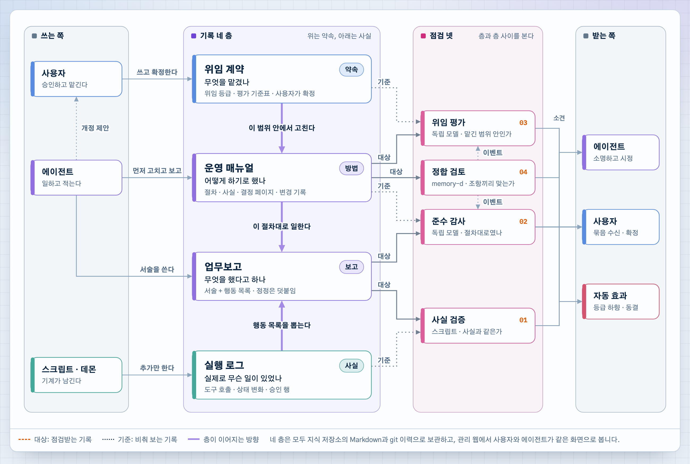
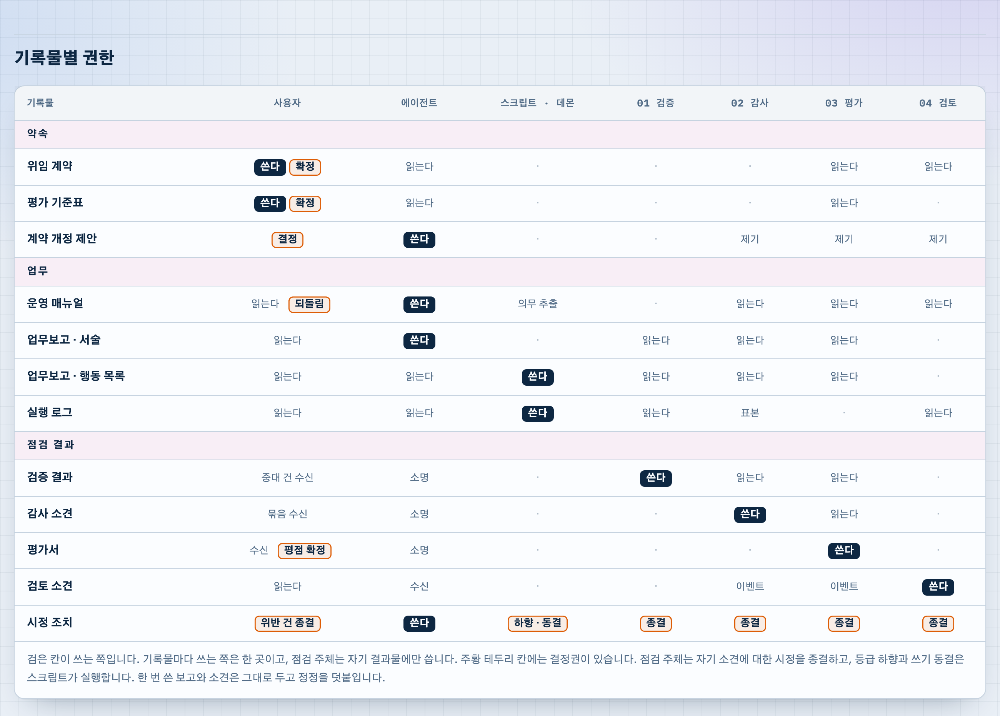

# 사례 1. 개인 에이전트 시스템의 기록 네 층과 점검 넷

[English](../en/cases/01-record-layers-and-checks.md) · [README로 돌아가기](../README.md)

한 독자가 자신의 개인 에이전트 시스템을 Harnel 배치도의 형식으로 분석했습니다. 사용자는 한 명이고 에이전트도 하나입니다. 이 문서는 작성자의 허락을 받아 그 분석에서 그림 두 장을 발췌한 것입니다.

> **수록 범위** 아래 그림 두 장만 수록합니다. 원문의 나머지는 이 저장소에 공개하지 않습니다. 소유자의 호칭과 에이전트의 이름은 「사용자」와 「에이전트」로, 문서 저장소와 웹 화면의 이름은 일반 명칭으로 바꿨습니다. 그 밖의 내용은 수정하지 않았습니다. 발췌한 그림은 허락을 받아 수록한 것이며 이 저장소의 CC BY 4.0 라이선스 적용 대상이 아닙니다.

## 이 사례를 수록한 이유

Harnel은 에이전트가 어디서 실행되고 무엇까지 허용되는지를 정의합니다. 그 다음 질문은 상대적으로 덜 다룹니다. 사용자가 작업을 위임한 뒤, 모든 내용을 직접 읽지 않고도 작업이 합의한 대로 수행됐는지 어떻게 확인하는가 하는 질문입니다. 이 시스템은 이 질문을 문서로 해결합니다. 기록을 네 종류로 나누고, 서로 어긋날 수 있는 기록 사이마다 점검을 하나씩 배치합니다.

## 그림 1. 기록 네 층과 점검 넷

  

기록 네 종류는 위에서 아래로 약속에서 사실 순서로 놓입니다.

| 기록 | 답하는 질문 | 쓰는 주체 | 변경 방식 |
| --- | --- | --- | --- |
| 위임 계약 | 무엇을 위임했는가 | 사용자 | 사용자만 변경을 확정합니다. 에이전트와 점검 주체는 개정을 제안할 수 있습니다. |
| 운영 매뉴얼 | 작업을 어떻게 수행하기로 했는가 | 에이전트 | 에이전트가 먼저 수정하고 사후에 보고합니다. 사용자는 되돌릴 수 있습니다. |
| 업무보고 | 에이전트가 무엇을 했다고 하는가 | 서술은 에이전트가 쓰고, 행동 목록은 스크립트가 로그에서 추출합니다. | 작성한 보고는 수정하지 않고 정정을 추가합니다. |
| 실행 로그 | 실제로 무슨 일이 있었는가 | 데몬과 스크립트 | 추가만 가능합니다. 에이전트는 쓸 수 없습니다. |

점검은 각각 기록 두 개를 비교합니다. 하나는 점검받는 기록(그림의 「대상」)이고 다른 하나는 비교 기준이 되는 기록(그림의 「기준」)입니다.

| 점검 | 대상 | 기준 | 수행 주체 | 확인하는 것 |
| --- | --- | --- | --- | --- |
| 01 사실 검증 | 업무보고의 서술 | 실행 로그에서 추출한 행동 목록 | 스크립트 | 보고가 사실과 같은가 |
| 02 준수 감사 | 업무보고 | 운영 매뉴얼 | 독립 모델 | 절차대로 수행했는가 |
| 03 위임 평가 | 운영 매뉴얼의 변경분 | 위임 계약 | 독립 모델 | 수정이 위임한 범위 안인가 |
| 04 정합 검토 | 운영 매뉴얼 | 운영 매뉴얼의 다른 조항 | 백그라운드 데몬 | 조항끼리 서로 맞는가 |

점검의 소견은 세 곳으로 전달됩니다. 에이전트는 소명하고 시정합니다. 사용자는 소견을 묶음으로 받아 확정합니다. 세 번째는 자동 효과로, 위임 등급 하향과 쓰기 동결입니다.

## 그림 2. 기록물별 권한

  

표의 행은 기록물이고 열은 주체입니다. 주체는 사용자, 에이전트, 스크립트와 데몬, 점검 넷입니다. 이 표에서 규칙 세 가지를 읽을 수 있습니다.

- **기록물마다 쓰는 주체는 하나입니다.** 검은 칸(「쓴다」)은 행마다 한 번만 나옵니다. 에이전트는 매뉴얼과 업무보고의 서술을 씁니다. 스크립트는 행동 목록과 실행 로그를 씁니다. 각 점검은 자기 결과물만 씁니다.
- **결정 권한은 쓰기 권한과 분리되어 있습니다.** 주황 테두리 칸에는 결정 권한이 있습니다. 사용자는 계약과 평가 기준표를 확정하고, 개정 제안을 결정하고, 매뉴얼을 되돌릴 수 있습니다. 각 점검은 자기 소견에 대한 시정 조치를 종결합니다. 등급 하향과 쓰기 동결은 에이전트나 모델이 아니라 스크립트가 실행합니다.
- **에이전트는 자신을 점검하는 기준이 되는 기록을 쓸 수 없습니다.** 에이전트는 위임 계약과 실행 로그를 읽기만 합니다.

## Harnel과의 대응

| 이 사례 | Harnel에서 가장 가까운 부분 | 차이 |
| --- | --- | --- |
| 실행 로그 | 각 호스트의 감사 로그와 작업 원장 ([2계층](../layers/02-gateway.md), [6계층](../layers/06-agent-host.md)) | 역할이 같습니다. 에이전트가 쓸 수 없는 기록입니다. |
| 위임 계약 | 프로필과 정책 등록부 ([2계층](../layers/02-gateway.md)) | 프로필은 허용 경로와 승인자를 나열합니다. 위임 계약은 여기에 더해 위임 등급과 에이전트를 평가하는 기준표를 포함합니다. |
| 운영 매뉴얼, 업무보고 | 지식 위키 ([7계층](../layers/07-knowledge.md)) | Harnel은 규칙과 완료 보고를 위키에 보관합니다. 에이전트가 자신의 절차를 먼저 수정하고 사후에 보고하는 방식은 정의하지 않습니다. |
| 01 사실 검증 | 리뷰어의 재검증 ([7계층](../layers/07-knowledge.md)) | Harnel도 에이전트의 자체 완료 보고를 근거로 인정하지 않습니다. 이 사례는 모든 보고를 스크립트로 로그와 대조합니다. |
| 02~04, 자동 효과 | 없음 | Harnel에는 절차 준수 점검, 매뉴얼을 계약이나 매뉴얼 자신과 대조하는 점검, 소견에 따른 자동 조치가 없습니다. |

둘째 행과 다섯째 행이 이 사례에서 드러난 Harnel의 공백입니다. 미결 사항으로 기록해 두며, 계층 문서에는 아직 반영하지 않았습니다.

## 한계

- 원문은 시스템을 완성 시점 기준의 청사진으로 서술합니다. 이 문서는 모든 점검이 구현되어 실행 중이라고 주장하지 않습니다.
- 사용자가 한 명이고 에이전트가 하나인 시스템입니다. 여러 사용자가 여러 에이전트에 위임하는 경우에 점검 넷을 어떻게 적용하는지는 그림에 나오지 않습니다.
- 이 문서는 그림 두 장을 요약한 것입니다. 원문의 비공개 부분에만 있는 내용은 다루지 않습니다.
