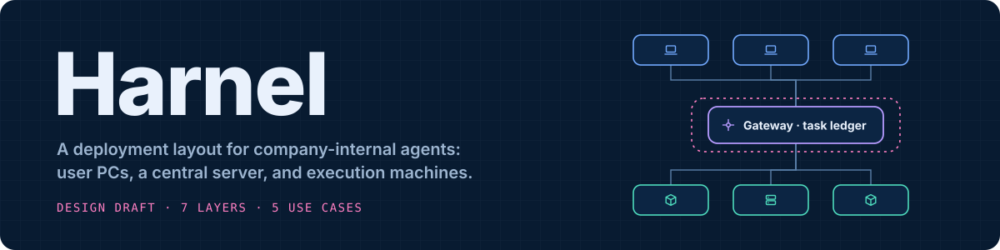
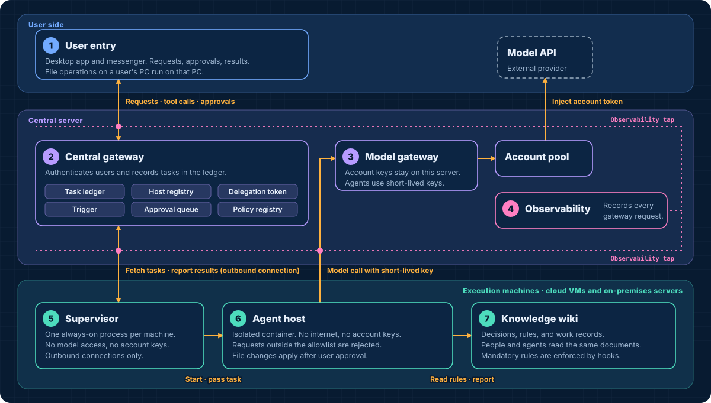
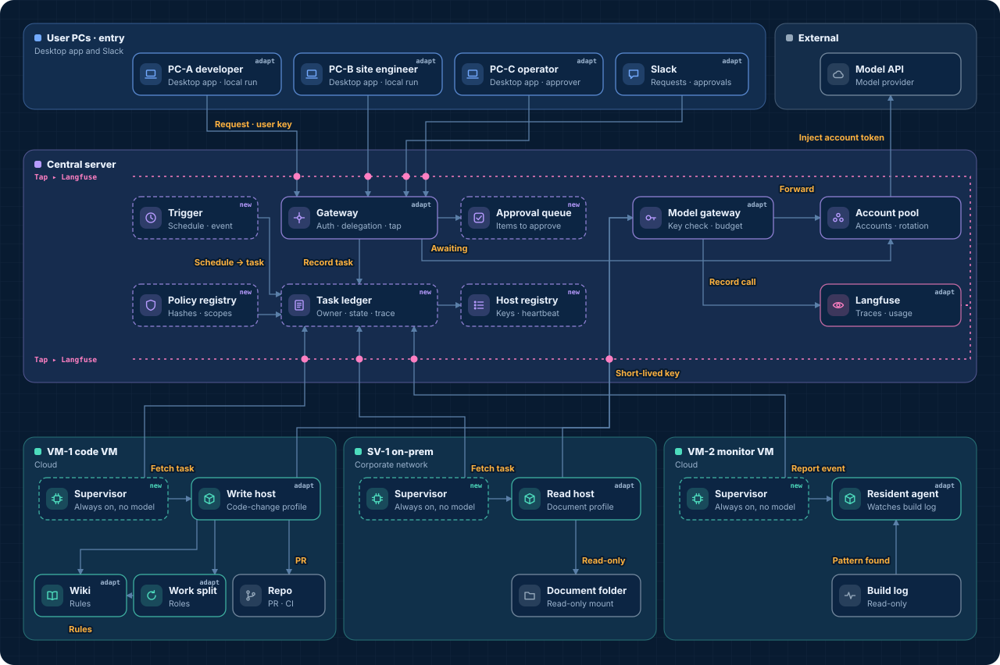
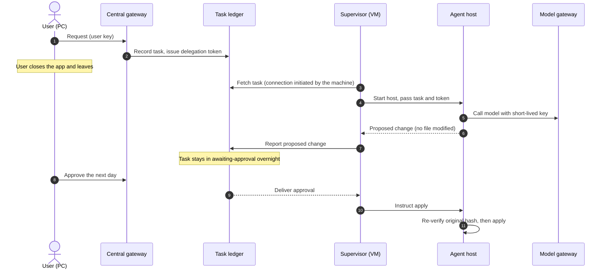

<p align="center">
  
</p>

# Harnel

Harnel is the name of a deployment layout for company-internal AI agents. It places agents on user PCs, one central server, and execution machines (cloud VMs and on-premises servers), and manages them from one place. In this document, an agent is an AI program that completes a task by calling tools on its own.

Every component in the layout already exists as a product or an open-source project. This repository defines how those components are divided into layers, and what each layer is and is not responsible for.

> **Status** Design draft. This repository contains no runnable implementation. Parts of each layer have been built and run separately. The layout as a whole has not been implemented or verified end to end.

**[Interactive floor plan (in Korean)](https://dominic-dk.github.io/harnel/)** · [Seven layers](#seven-layers) · [Use cases](usecases.md) · [Cases](#cases) · [Relation to existing products](#relation-to-existing-products) · [한국어](../README.md)

## Overview

<p align="center">
  
</p>

Deploying agents inside a company raises four questions. Who requested this task? Where does it run? What is it allowed to do? Can we see afterwards what happened? Harnel assigns these questions to seven layers.

| | Layer | Responsible for | Not responsible for |
| --- | --- | --- | --- |
| 1 | [User entry](layers/01-entry.md) | Accepts requests and approvals and shows results. File operations on a user's PC run on that PC. | Does not store task state. A task continues after the app is closed. |
| 2 | [Central gateway](layers/02-gateway.md) | Authenticates users, records tasks in the task ledger, dispatches tasks to execution machines, and collects approvals. | Does not execute tools. Does not open connections to execution machines. |
| 3 | [Model gateway](layers/03-model-gateway.md) | Stores model account keys, verifies short-lived keys, and enforces budgets. | Does not decide what work to do. |
| 4 | [Observability](layers/04-observability.md) | Records the acceptance, dispatch, and completion of every request the gateway handles. | Does not delay or block requests. Is not the source of truth for authorization decisions. |
| 5 | [Supervisor](layers/05-supervisor.md) | Registers the machine, fetches tasks, starts and stops agent hosts, and reports results. | Does not call models. Does not run arbitrary commands. |
| 6 | [Agent host](layers/06-agent-host.md) | Runs agents in an isolated container, evaluates policy, and pauses before any write. | Has no direct internet access. Holds no account keys. |
| 7 | [Knowledge wiki](layers/07-knowledge.md) | Keeps decisions, rules, and work records as documents that both people and agents read. | Does not hold live state. |

## Five design decisions

The layer boundaries follow from five decisions. Each decision lists products that made a similar one, based on public documentation as of November 2026.

**1. The task ledger owns the task, not the app.**
If the user's PC is the executor, work stops when the app closes. Every request is therefore recorded first in the task ledger on the central server. The task ledger stores who requested a task, which machine it is assigned to, and its current state. The app becomes a client that creates tasks and reads their state.
Similar decision: [Mission Control](https://github.com/builderz-labs/mission-control), [Preloop](https://github.com/preloop/preloop)

**2. Execution machines open outbound connections only.**
The central server never connects to an execution machine. Each machine connects to the central server and fetches its own tasks. A server inside the corporate network can join without any new inbound firewall rule. If one machine is compromised, it has no network path to the other machines.
Similar decision: [Cursor self-hosted cloud agents](https://cursor.com/blog/self-hosted-cloud-agents), [Claude Managed Agents: self-hosted sandboxes](https://platform.claude.com/docs/en/managed-agents/self-hosted-sandboxes)

**3. Model account keys exist only behind the model gateway.**
An agent receives a short-lived key that is valid for one task. The gateway rejects any request outside the allowed models, paths, and daily budget. Compromising an execution machine does not expose an account key.
Similar decision: [Coder AI Gateway](https://coder.com/solutions/ai-governance)

**4. A task that no user requested does not run with a user's permissions.**
An agent started by a schedule or an event runs under a service identity that belongs to that trigger and has restricted permissions. It may read and draft on its own. Any file change waits for a user's approval. Approval authority is tied to the user account, not to a session, so the user can approve from another PC or from a messenger while the requesting app is closed.
Similar decision: per-agent identities in [Microsoft Agent 365](https://www.microsoft.com/en-us/microsoft-agent-365)

**5. Every request the gateway handles is recorded.**
The gateway has an observability tap on the user side and another on the execution-machine side. A tap sends a record separately from request processing, so it adds no latency. A task keeps one trace ID as it moves from a PC to the central server and on to an execution machine, which shows where time was spent and where the task failed. Tasks continue when the observability server is down.
Example tool: [Langfuse](https://github.com/langfuse/langfuse)

## Floor plan

<p align="center">
  
</p>

The floor plan places the components on seven fictional machines: three PCs, one central server, two cloud VMs, and one on-premises server. A dashed border marks a component that must be newly built for this layout. The label `adapt` marks an existing component that needs modification. A component without a label is used as is. The pink dashed lines are the observability taps.

In the [interactive floor plan](https://dominic-dk.github.io/harnel/), which is currently in Korean, you select a use case and step through it. Each step highlights the components and connections involved. Selecting a component opens its internal structure.

## Seven layers

Each layer document uses the same sections: responsibilities, out of scope, checks at the boundary, data exchanged, failure behavior, and open questions. The documents are written so that you can use them as a checklist for your own implementation.

1. **[User entry](layers/01-entry.md)**: a desktop app and a messenger integration. Files on a user's PC are handled only on that PC. A write goes to a working copy first and is applied to the original after the user reviews it.
2. **[Central gateway](layers/02-gateway.md)**: the task ledger, host registry, delegation tokens, triggers, approval queue, and policy registry. The document defines the task state machine and the fields of a delegation token.
3. **[Model gateway](layers/03-model-gateway.md)**: seven processing steps, from short-lived key verification to usage accounting.
4. **[Observability](layers/04-observability.md)**: what is recorded, what is not, and how it differs from an audit log.
5. **[Supervisor](layers/05-supervisor.md)**: the only process that is always running on an execution machine. Its command set is fixed at seven commands.
6. **[Agent host](layers/06-agent-host.md)**: the nine checkpoints a request passes, and the three operations that require approval.
7. **[Knowledge wiki](layers/07-knowledge.md)**: rules are written as documents, mandatory rules are enforced by hooks, and multi-step work is split among a manager, a worker, and a reviewer.

## Use cases

The layout was checked against five situations. [usecases.md](usecases.md) describes each flow.

| Use case | What it verifies |
| --- | --- |
| Working on a folder on my PC | The baseline flow that executes on the user's PC, and its limitation |
| Handing off before leaving work | The task continues after the app is closed and is completed by an approval the next day |
| Document check at 07:00 | How permissions are restricted when a schedule starts a task with no user present |
| Automatic response to a build failure | The procedure by which a resident monitoring agent starts an agent on another machine |
| A compromised on-premises server | Where each attempt is blocked when one execution machine is compromised, and what remains exposed |

The flow of the second use case:



## Cases

Analyses that other people made of their own systems in the format of this floor plan, excerpted in part with the authors' permission.

| Case | Content |
| --- | --- |
| [1. Four record layers and four checks](cases/01-record-layers-and-checks.md) | A personal agent system that separates the delegation contract, operations manual, work report, and execution log, and places four checks between them. The page also lists what Harnel lacks. |

## Relation to existing products

This comparison is based on public documentation and repositories as of November 2026. It is not a hands-on evaluation, and the scope of each product keeps changing.

| Product | Overlapping layers | Difference |
| --- | --- | --- |
| [Claude Managed Agents: self-hosted sandboxes](https://platform.claude.com/docs/en/managed-agents/self-hosted-sandboxes) | 5. A work queue and a worker on the customer's machine. The worker needs outbound access only. | The agent loop runs on the provider's side. |
| [Cursor self-hosted cloud agents](https://cursor.com/blog/self-hosted-cloud-agents) | 5. The same model. | Coding only. |
| [Coder](https://coder.com/solutions/ai-governance) | 3, 6. A gateway whose provider keys never leave the control plane, and a default-deny agent firewall. | Coding only. |
| [Preloop](https://github.com/preloop/preloop) | 2, 3, 5. Tool-call firewall, model gateway, triggers, runners connected over outbound connections, approvals. | The closest structure. Local execution on user PCs and a knowledge layer are outside its scope. |
| [Mission Control](https://github.com/builderz-labs/mission-control) | 2. Task intake and assignment, agent registration, approvals, cost. | Does not cover execution or isolation. |
| [agentgateway](https://github.com/agentgateway/agentgateway) | 3. A policy gateway for traffic among agents, tools, and models. | Does not cover execution machines or a task ledger. |
| [Microsoft Agent 365](https://www.microsoft.com/en-us/microsoft-agent-365) | 2. Agent registry, per-agent identity, policy. | A governance layer, not an execution architecture. |
| [OpenClaw](https://github.com/openclaw/openclaw) | 2, 5. Multiple devices connect to one gateway as nodes. | For personal use. |

Harnel focuses on three things. It handles tasks that run on a user's PC and tasks that run unattended on a server in one ledger. It treats a wiki of decisions and rules as a layer of the architecture. It is not tied to one provider, and it is sized so that a small organization can start with a few PCs and a few servers.

## Build order

The layout is built in five stages. Each stage is verified by running one use case.

| Stage | What is added | What works afterwards |
| --- | --- | --- |
| 1 | Deploy the gateway, model gateway, account pool, and observability server on the central server. Add the user-side observability tap. | A folder task on a user's PC runs through the central server, and its records are visible. |
| 2 | Add the task ledger, host registration, task fetching, and result reporting. | A task can complete with no app connected, tested with a stub host. |
| 3 | Deploy a supervisor and a read-only profile on one execution machine. Add one scheduled trigger. | The morning document check runs with no user present. |
| 4 | Add delegation tokens and the approval queue. Enable a host with write access. | A task handed off in the evening is approved and completed the next day. |
| 5 | Add the policy registry, event triggers, and wiki-based work splitting. | The automatic response to a build failure works, and all blocking points are in place. |

## Out of scope

- **A model-driven orchestrator that assigns tasks.** Which trigger starts which agent is defined in configuration. Decomposition into steps happens only inside a single task.
- **Kubernetes as a prerequisite.** The layout targets a scale that starts with a few containers and OS service units.
- **Model selection and prompts.** The layers are defined so that the structure is the same for any model.

## Glossary

| Term | Meaning |
| --- | --- |
| Task ledger | The store on the central server that records who requested a task, which machine it is assigned to, and its current state |
| Supervisor | A small process that is always running on each execution machine. It only receives tasks and starts and stops agents. |
| Host | The container in which an agent runs. It is the permission boundary. |
| Profile | The policy file of one agent. It defines readable paths, writable paths, the denylist, and approvers. |
| Delegation token | A short-lived signed token issued by the central server that carries the user, profile, task ID, and expiry |
| Service identity | An identity with restricted permissions that is assigned to a trigger in place of a user |
| Observability tap | The point at which the gateway sends a record to the observability server each time it accepts or forwards a request |

## Regenerating the diagrams

The three diagrams in this README are generated from the coordinates and component list in `docs/index.html`. After editing the floor plan, run:

```sh
node tools/build-assets.mjs
```

## License

The documents, diagrams, and scripts in this repository are licensed under [CC BY 4.0](../LICENSE). You may copy, modify, and redistribute them with attribution. The figures in `assets/cases/` are excerpted with their author's permission and are not covered by this license.
