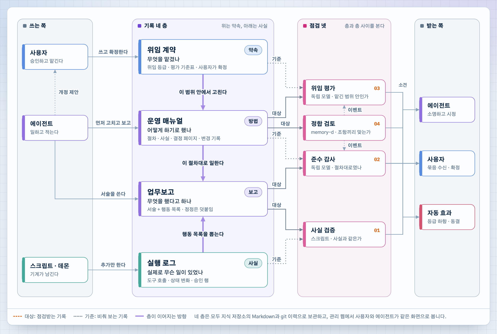
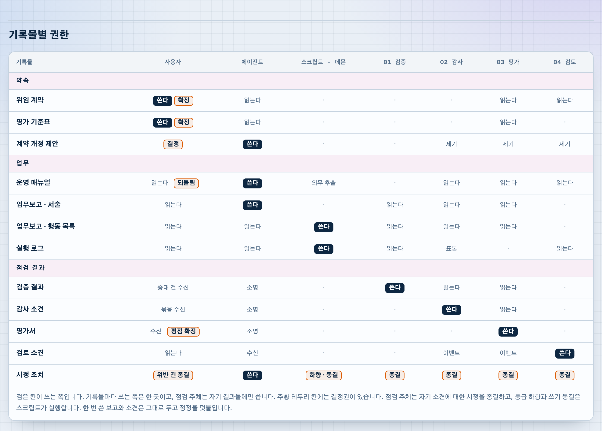

# Case 1. Four record layers and four checks in a personal agent system

[한국어](../../cases/01-record-layers-and-checks.md) · [Back to README](../README.md)

A reader analyzed their own personal agent system in the format of the Harnel floor plan. The system has one user and one agent. This page excerpts two figures from that analysis with the author's permission.

> **Scope of the excerpt.** Only the two figures below are included. The rest of the original is not published here. The name of the owner and the name of the agent were replaced with "사용자" (user) and "에이전트" (agent), and the names of the document store and the web screen were replaced with generic terms. Nothing else in the figures was changed. The figures are in Korean. They are excerpted with permission and are not covered by this repository's CC BY 4.0 license.

## Why this case is here

Harnel defines where an agent runs and what it is allowed to do. It says less about a later question: after the user delegates work, how does the user know that the work was done as agreed without reading everything? This system answers that question with documents. It keeps four kinds of records and places one check between each pair of records that can disagree.

## Figure 1. Four record layers and four checks

  

The four records are stacked from agreement at the top to fact at the bottom.

| Record | Question it answers | Writer | How it changes |
| --- | --- | --- | --- |
| Delegation contract | What was delegated | User | Only the user confirms a change. The agent and the checks may propose a revision. |
| Operations manual | How the work is to be done | Agent | The agent edits first and reports afterward. The user can roll a change back. |
| Work report | What the agent says it did | Agent writes the narrative. A script extracts the action list from the log. | A report is not edited. A correction is appended. |
| Execution log | What actually happened | Daemons and scripts | Append only. The agent cannot write to it. |

Each check compares two records. One is the record being checked (labeled 대상, target, in the figure). The other is the record it is checked against (labeled 기준, reference).

| Check | Target | Reference | Performed by | What it asks |
| --- | --- | --- | --- | --- |
| 01 Fact verification | Narrative of the work report | Action list extracted from the execution log | Script | Does the report match the facts? |
| 02 Compliance audit | Work report | Operations manual | Independent model | Was the procedure followed? |
| 03 Delegation evaluation | Changes to the operations manual | Delegation contract | Independent model | Is the edit within the delegated scope? |
| 04 Consistency review | Operations manual | Other clauses of the manual | Background daemon | Are the clauses consistent with each other? |

Findings go to three places. The agent explains and corrects. The user receives findings in batches and confirms them. The third is an automatic effect: the delegation grade is lowered, or writing is frozen.

## Figure 2. Permissions per record

  

The table has one row per record and one column per actor: the user, the agent, scripts and daemons, and the four checks. Three rules can be read from it.

- **Each record has exactly one writer.** The dark cells (쓴다, writes) appear once per row. The agent writes the manual and the narrative of the report. Scripts write the action list and the execution log. Each check writes only its own result.
- **Deciding is separate from writing.** The cells with an orange border carry a decision: the user confirms the contract and the scoring sheet, decides on proposed revisions, and can roll back the manual. Each check closes the corrective action for its own finding. Lowering a grade and freezing writes are executed by a script, not by the agent or a model.
- **The agent cannot write the records it is checked against.** The agent reads the contract and the execution log and writes neither.

## How this maps to Harnel

| In this case | Closest part of Harnel | Difference |
| --- | --- | --- |
| Execution log | Audit log of each host and the task ledger ([layer 2](../layers/02-gateway.md), [layer 6](../layers/06-agent-host.md)) | Same role: the record the agent cannot write. |
| Delegation contract | Profiles and the policy registry ([layer 2](../layers/02-gateway.md)) | A profile lists allowed paths and approvers. The contract also contains delegation grades and the sheet used to evaluate the agent. |
| Operations manual, work report | Knowledge wiki ([layer 7](../layers/07-knowledge.md)) | Harnel keeps rules and completion reports in the wiki. It does not define a way for the agent to edit its own procedures first and report afterward. |
| 01 Fact verification | Re-verification by the reviewer ([layer 7](../layers/07-knowledge.md)) | Harnel also does not accept an agent's own completion report as evidence. This case compares the report with the log by script for every report. |
| 02 to 04, automatic effects | None | Harnel has no check of procedure compliance, no check of the manual against the contract or against itself, and no automatic consequence of a finding. |

The second and fifth rows are the gaps this case shows in Harnel. They are recorded as open questions and are not yet reflected in the layer documents.

## Limits

- The original describes the system as a blueprint at the point of completion. This page does not claim that every check is implemented and running.
- This is a system with one user and one agent. The figures do not show how the four checks would apply when many users delegate to many agents.
- This page summarizes two figures. Details that appear only in the unpublished part of the original are not described here.
