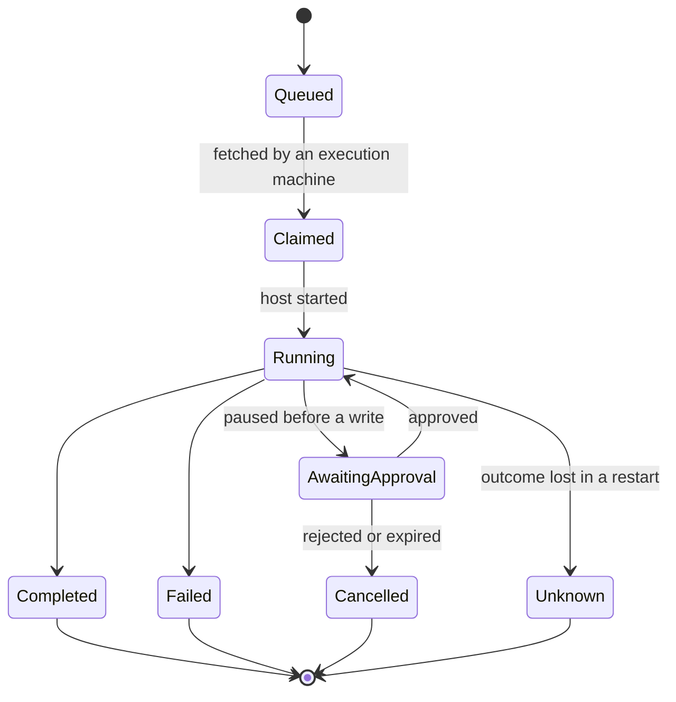

# 2. Central gateway

The server that authenticates users, records tasks, and relays requests between users and execution machines. Most of the components that must be newly built for this layout are in this layer.

## Responsibilities

| Component | Function |
| --- | --- |
| User authentication | Identifies the user by user key. |
| Task ledger | Stores the owner, target, and state of each task. A task proceeds with no app connected. |
| Host registry | Stores each execution machine's registration key, heartbeat, and the profiles it can run. |
| Delegation token | Carries the identity under which a task runs to the execution machine. |
| Trigger | Converts schedules, webhooks, and events from execution machines into tasks in the ledger. |
| Approval queue | Holds items that require a user's approval. |
| Policy registry | Stores the hash of each profile and the set of profiles each trigger may start. |
| Observability tap | Sends records of request acceptance, dispatch, and completion to the observability server. |

## Out of scope

- Executing tools.
- Connecting to execution machines. Machines fetch their tasks.
- Letting a model assign tasks. Which trigger starts which profile is defined in configuration.

## Task states

`Unknown` means that the central server or the execution machine restarted and the outcome cannot be determined. The task is not re-executed automatically. A user must check it. This rule prevents the same write from being applied twice.

## Data exchanged

**Task (one ledger entry)**

| Field | Description |
| --- | --- |
| Task ID | Also the deduplication key for requests. The same ID with the same content returns the existing task. |
| Owner | A user, or the service identity of a trigger |
| Target | Execution machine and profile |
| State | One of the states above |
| Source | User request, schedule, webhook, or machine event |
| Deduplication key | Set on tasks created by triggers. Only one task per key is kept. |
| Trace ID | Links the task to observability records |

**Delegation token**

| Field | Description |
| --- | --- |
| Subject | A user or a service identity |
| Profile | The one profile this token may be used with |
| Task ID | Valid for this task only |
| Execution machine | Valid on this machine only |
| Expiry | Short |
| Signature | Signed with the gateway's key and verified by the host |

**Approval item**

| Field | Description |
| --- | --- |
| Type | Note, temporary read access, code change, or write proposal |
| Content hash | If the content changes after approval, a new approval is required. |
| Target and policy hash | If the target or the policy changes, a new approval is required. |
| Eligible approvers | The requester for a user-requested task. The approvers listed in the profile for a trigger-started task. |

## Checks at the boundary

- A task is recorded in the ledger only after the gateway confirms that the user may use the profile.
- The gateway compares the profile hash reported by an execution machine with the value in the policy registry. On a mismatch it suspends the host and assigns it no new tasks.
- A task request from an execution machine is accepted only within the trigger scope registered for that machine.
- Each trigger has a deduplication key and a concurrency limit. This prevents a loop in which a task fires a trigger that creates another task.

## Failure behavior

- **The central server is down**: Execution machines start no new tasks. There is a single central server, so it must run on a machine that does not sleep.
- **The central server restarts**: Tasks that were running are recorded as `Unknown`.
- **The observability server is down**: Request processing is not affected.

## Open questions

- Whether to authenticate users with keys issued by the gateway or with the company's single sign-on.
- When an approval expires, whether to regenerate and resubmit the proposal or to close the task.
- At what scale a second central server becomes necessary.
