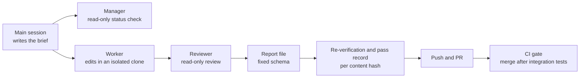

# 7. Knowledge wiki

A Markdown wiki that holds decisions, rules, and work records. People and agents read the same documents. Rules are kept in one defined place, so they do not have to be restated in every prompt.

## Responsibilities

- Store the team's decisions and rules as documents. For example, the rule "truncate amounts to whole won" is recorded here.
- Define which documents an agent reads before it starts a task.
- Receive the reports that agents write when they finish a task.
- Define how multi-step work is divided among agents.

## Out of scope

- Holding live state. Who is doing what at this moment is in the task ledger on the central server. The wiki holds completion reports only.
- Enforcing rules. Documents are for reading. Mandatory rules are enforced in code by hooks.

## Structure

| Location | Content |
| --- | --- |
| Sources | Material as received. Never edited or deleted. |
| Wiki pages | Summaries written and maintained by agents. Every claim cites the path of its source. |
| Schema | The document that defines how the wiki is organized and written. Read before working on the wiki. |
| Index and log | Where things are, and what changed when |
| Inbox | Where agent reports arrive. Each report carries a task ID and a trace ID. |
| Team definitions | Which repository is handled on which execution machine by which roles |

## Dividing multi-step work

Work that needs several steps, such as fixing a build failure, is not given to one agent as a whole. It is divided.

| Role | Function | Not permitted |
| --- | --- | --- |
| Main session | Reads the team page and writes the brief. Re-runs the checks on the result and records a pass. | |
| Manager | Checks status. | Writing |
| Worker | Makes changes in an isolated clone. The rules it must follow are attached to the brief. | Committing, writing outside the clone |
| Reviewer | Reviews the worker's changes and gives a verdict. | Writing |

## Checks at the boundary

- **Hooks block two things.** A commit or a write outside the clone by a worker, and a push of content that has no pass record. A self-report that the work is done is not accepted as evidence.
- **Execution machines receive the wiki read-only.** They write only through the inbox.
- **A pass record is stored with the content hash.** If the content changes after verification, the record is no longer valid.
- **Model calls made by sub-agents also go through the model gateway.**

Messaging between sessions on the same machine is outside this layer and is handled by a separate tool. Delivery between machines is handled by the task ledger.

## Failure behavior

- **The reviewer does not pass the change**: It is returned to the worker. There is a retry limit. Beyond the limit, the task is escalated to a user.
- **Re-verification fails**: No pass record is written, so the push is blocked.
- **Rules in the wiki contradict each other**: A lint task finds the contradiction and places it in the approval queue. An agent does not delete one side on its own.

## Open questions

- How to limit what an agent reads each time as the wiki grows. The current answer is one team page and a few lines of rules.
- How to reconcile a user's direct edit of the wiki with the summaries that agents wrote.
