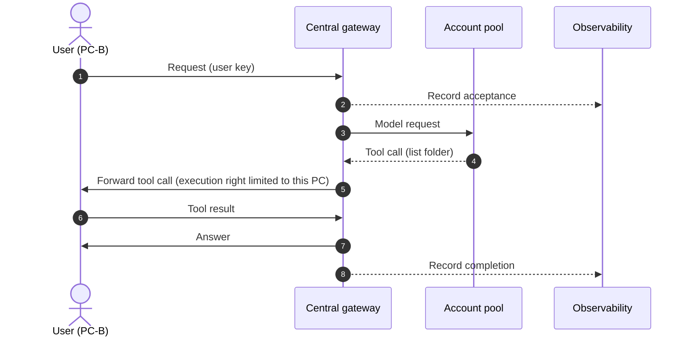
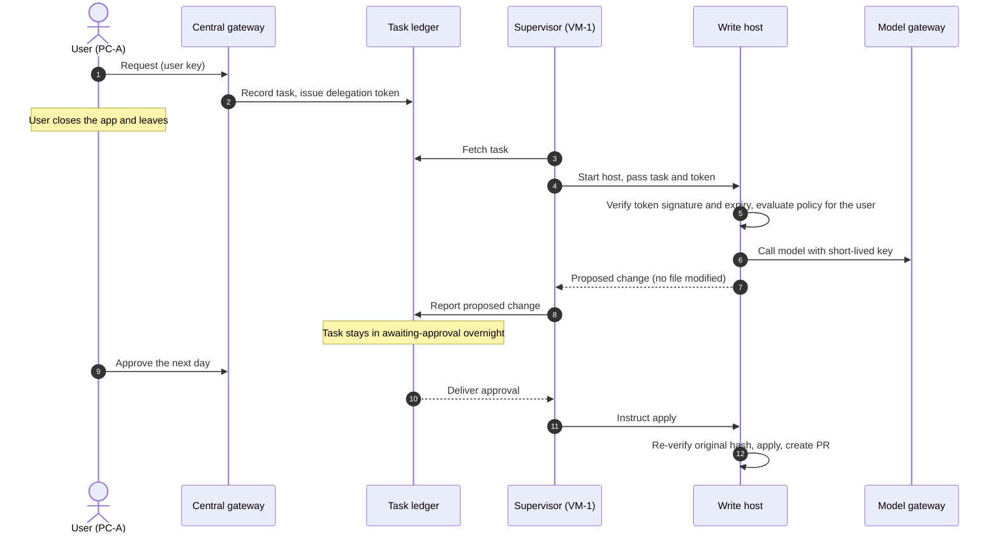
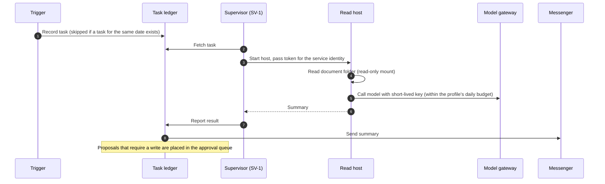
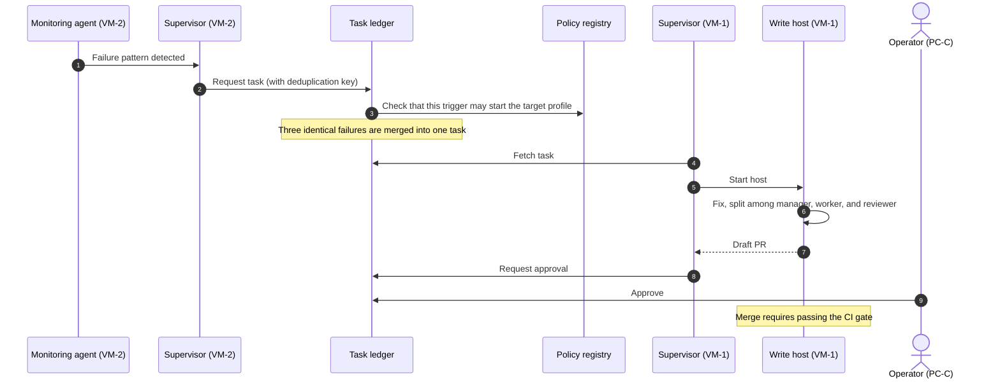

# Use cases

The layout is checked against five situations. All machines, people, and requests are fictional. The [interactive floor plan](https://dominic-dk.github.io/harnel/) shows the same flows step by step.

There are seven fictional machines: PC-A (a developer's laptop), PC-B (a site engineer's laptop), PC-C (an operator's laptop), the central server, VM-1 (code VM), SV-1 (an on-premises server that holds documents), and VM-2 (monitoring VM).

## 1. Working on a folder on my PC

A site engineer enters "Sort this week's site photo folder by date and produce a list" in the desktop app on PC-B. The files exist only on PC-B, so execution takes place on PC-B.

- **Layers required**: 1, 2, 3, 4
- **Limitation**: PC-B is the executor, so closing the app cancels the task. Work that must run while the user is away uses the model in the next use case.

## 2. Handing off before leaving work

Before leaving, a developer requests "Fix the rounding error in settlement amounts" and selects VM-1 as the execution location. The developer closes the app and leaves.

- **Layers required**: all seven
- **What it verifies**: The ledger owns the task, so the task proceeds after the app is closed. Approval authority is tied to the user account, so approving from another PC or a messenger has the same effect. Immediately before applying, the host verifies that the file is unchanged since the proposal was created.

## 3. Document check at 07:00

At a time when no one is at work, a trigger creates the task "Summarize the official letters and meeting minutes received yesterday and find items with a reply deadline."

- **Layers required**: 2, 3, 4, 5, 6
- **What it verifies**: No user requested this task, so it does not use a user's permissions. It runs under the service identity of the trigger, which permits reading and drafting only. A write is recorded as a proposal and runs as a separate task after an operator approves it.

## 4. Automatic response to a build failure

The monitoring agent on VM-2 stays running and watches the build log. It detects that the same test has failed several times in a row.

- **Layers required**: 2 through 7
- **What it verifies**: The monitoring machine has no permission to modify code, so it does not fix the failure itself and requests a task through the ledger. Authorization, budget, and records apply only when every execution goes through the ledger. The service identity may create a draft PR and nothing more.

## 5. A compromised on-premises server

Assume an attacker has taken control of SV-1. The table shows where each attempt is blocked.

| Attempt | Blocked at | Reason |
| --- | --- | --- |
| Use instructions injected into a document to make the agent read certificates and key files | The tools of the agent host | Tool code, not the model, decides whether a path is allowed. A file on the denylist cannot be opened by any approval. |
| Extract the model account | Model gateway | The machine holds only a short-lived key valid for one task. Requests outside the allowed models, paths, and budget are rejected. |
| Make another machine run a task | Task ledger | An execution machine can only fetch and report its own tasks. A task request is accepted only within the trigger scope registered for that machine. |
| Edit the policy file to widen permissions | Policy registry | Editing the file changes its hash. If the hash differs from the registered value, the host is suspended. |
| Connect to a user PC or another VM | No path exists | Every machine opens outbound connections to the central server only. |

- **Remaining exposure**: The document folder mounted on SV-1 can be read, and model usage up to the daily budget can occur. For this reason the mounted folder is kept minimal and each profile has its own budget.
- **Evidence**: Rejected attempts are recorded in the host's audit log, the task ledger, and the observability server, and can be reviewed together.
