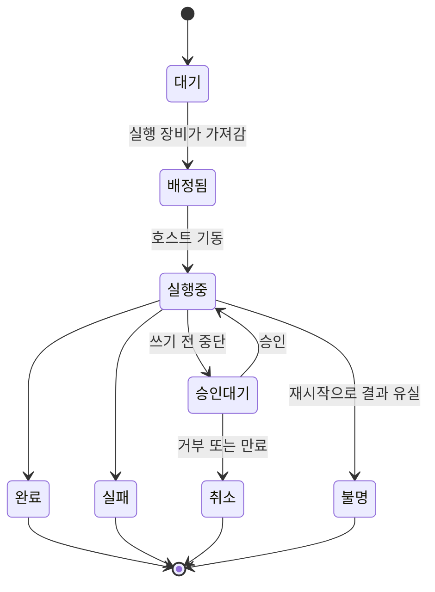

# 2. 중앙 게이트웨이

사용자를 인증하고, 작업을 기록하고, 사용자와 실행 장비 사이에서 요청을 중계하는 서버입니다. 이 구조를 위해 새로 구현해야 하는 구성 요소의 대부분이 이 계층에 있습니다.

## 책임

| 구성 요소 | 기능 |
| --- | --- |
| 사용자 인증 | 사용자 키로 사용자를 식별합니다. |
| 작업 원장 | 각 작업의 소유자, 대상, 상태를 저장합니다. 연결된 앱이 없어도 작업이 진행됩니다. |
| 호스트 등록부 | 각 실행 장비의 등록 키, 하트비트, 실행 가능한 프로필을 저장합니다. |
| 위임 토큰 | 작업이 어떤 신원으로 실행되는지를 실행 장비까지 전달합니다. |
| 트리거 | 예약, 웹훅, 실행 장비의 이벤트를 원장의 작업으로 변환합니다. |
| 승인 대기열 | 사용자 승인이 필요한 항목을 보관합니다. |
| 정책 등록부 | 각 프로필의 해시와, 각 트리거가 시작시킬 수 있는 프로필 집합을 저장합니다. |
| 관측 탭 | 요청의 수락, 전달, 완료 기록을 관측 서버로 전송합니다. |

## 책임 범위 밖

- 도구 실행.
- 실행 장비로의 접속. 장비가 작업을 가져옵니다.
- 모델에 의한 작업 배정. 어떤 트리거가 어떤 프로필을 시작시키는지는 설정으로 정의합니다.

## 작업 상태

`불명`은 중앙 서버나 실행 장비가 재시작되어 결과를 확인할 수 없는 상태입니다. 이 작업은 자동으로 재실행하지 않습니다. 사용자가 확인해야 합니다. 같은 쓰기가 두 번 적용되는 것을 방지하기 위한 규칙입니다.

## 교환하는 데이터

**작업 (원장 항목 1건)**

| 필드 | 설명 |
| --- | --- |
| 작업 ID | 요청의 중복 제거 키로도 사용합니다. 같은 ID와 같은 내용의 요청에는 기존 작업을 반환합니다. |
| 소유자 | 사용자 또는 트리거의 서비스 신원 |
| 대상 | 실행 장비와 프로필 |
| 상태 | 위 상태 중 하나 |
| 출처 | 사용자 요청, 예약, 웹훅, 장비 이벤트 |
| 중복 제거 키 | 트리거가 생성한 작업에 설정합니다. 키 하나당 작업 1건만 유지합니다. |
| trace ID | 작업을 관측 기록과 연결합니다. |

**위임 토큰**

| 필드 | 설명 |
| --- | --- |
| 주체 | 사용자 또는 서비스 신원 |
| 프로필 | 이 토큰을 사용할 수 있는 프로필 1개 |
| 작업 ID | 이 작업에만 유효 |
| 실행 장비 | 이 장비에서만 유효 |
| 만료 시각 | 짧게 설정 |
| 서명 | 게이트웨이의 키로 서명하고 호스트가 검증 |

**승인 항목**

| 필드 | 설명 |
| --- | --- |
| 종류 | 메모, 임시 읽기 권한, 코드 변경, 쓰기 제안 |
| 내용 해시 | 승인 후 내용이 바뀌면 새 승인이 필요합니다. |
| 대상과 정책 해시 | 대상이나 정책이 바뀌면 새 승인이 필요합니다. |
| 승인 가능한 사용자 | 사용자가 요청한 작업은 요청자. 트리거로 시작된 작업은 프로필에 지정된 승인자. |

## 경계에서의 검사

- 게이트웨이는 사용자가 해당 프로필을 사용할 수 있음을 확인한 뒤에만 작업을 원장에 기록합니다.
- 게이트웨이는 실행 장비가 보고한 프로필 해시를 정책 등록부의 값과 비교합니다. 일치하지 않으면 해당 호스트를 정지하고 새 작업을 배정하지 않습니다.
- 실행 장비의 작업 요청은 해당 장비에 등록된 트리거 범위 안에서만 수락합니다.
- 각 트리거에는 중복 제거 키와 동시 실행 상한이 있습니다. 작업이 트리거를 발생시키고 그 트리거가 다시 작업을 생성하는 순환을 방지합니다.

## 장애 시 동작

- **중앙 서버 중단**: 실행 장비는 새 작업을 시작하지 않습니다. 중앙 서버는 1대이므로 절전 상태로 전환되지 않는 장비에서 실행해야 합니다.
- **중앙 서버 재시작**: 실행 중이던 작업은 `불명`으로 기록됩니다.
- **관측 서버 중단**: 요청 처리에 영향이 없습니다.

## 미결 사항

- 사용자 인증에 게이트웨이가 발급한 키를 쓸지, 회사의 통합 로그인을 쓸지.
- 승인이 만료됐을 때 변경 제안을 다시 생성해 제출할지, 작업을 종료할지.
- 어느 규모에서 중앙 서버 2대가 필요해지는지.
