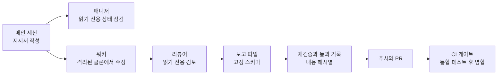

# 7. 지식 위키

결정 사항, 규칙, 작업 기록을 보관하는 마크다운 위키입니다. 사람과 에이전트가 같은 문서를 읽습니다. 규칙을 정해진 한 곳에 두므로 프롬프트마다 다시 작성할 필요가 없습니다.

## 책임

- 팀의 결정 사항과 규칙을 문서로 저장합니다. 예를 들어 "금액은 원 단위 미만을 절사한다"는 규칙이 여기에 기록됩니다.
- 에이전트가 작업을 시작하기 전에 읽을 문서를 정의합니다.
- 에이전트가 작업을 마치고 작성하는 보고를 수신합니다.
- 다단계 작업을 에이전트 간에 분담하는 방식을 정의합니다.

## 책임 범위 밖

- 실시간 상태 보관. 현재 누가 무엇을 하고 있는지는 중앙 서버의 작업 원장에 있습니다. 위키에는 완료 보고만 보관합니다.
- 규칙 강제. 문서는 읽기 위한 것입니다. 필수 규칙은 훅이 코드로 강제합니다.

## 구조

| 위치 | 내용 |
| --- | --- |
| 원본 | 수신한 자료 그대로. 수정하거나 삭제하지 않습니다. |
| 위키 페이지 | 에이전트가 작성하고 유지하는 요약본. 모든 주장에 출처 원본의 경로를 표기합니다. |
| 스키마 | 위키의 구성과 작성 방식을 정의하는 문서. 위키 작업 전에 먼저 읽습니다. |
| 색인과 변경 기록 | 무엇이 어디에 있는지, 언제 무엇이 바뀌었는지 |
| 수신함 | 에이전트의 보고가 도착하는 곳. 각 보고에는 작업 ID와 trace ID가 포함됩니다. |
| 팀 정의 | 어느 저장소를 어느 실행 장비에서 어떤 역할이 담당하는지 |

## 다단계 작업의 분담

빌드 실패 수정처럼 여러 단계가 필요한 작업은 에이전트 하나에 통째로 맡기지 않고 분담합니다.

| 역할 | 기능 | 허용되지 않는 것 |
| --- | --- | --- |
| 메인 세션 | 팀 페이지를 읽고 지시서를 작성합니다. 결과에 대해 검사를 다시 실행하고 통과를 기록합니다. | |
| 매니저 | 상태를 점검합니다. | 쓰기 |
| 워커 | 격리된 클론에서 변경합니다. 준수해야 할 규칙이 지시서에 첨부됩니다. | 커밋, 클론 밖 쓰기 |
| 리뷰어 | 워커의 변경을 검토하고 판정합니다. | 쓰기 |

## 경계에서의 검사

- **훅은 두 가지를 차단합니다.** 워커의 커밋과 클론 밖 쓰기, 그리고 통과 기록이 없는 내용의 푸시입니다. 작업을 완료했다는 자체 보고는 근거로 인정하지 않습니다.
- **실행 장비는 위키를 읽기 전용으로 받습니다.** 쓰기는 수신함을 통해서만 합니다.
- **통과 기록은 내용 해시와 함께 저장됩니다.** 검증 후 내용이 바뀌면 해당 기록은 유효하지 않습니다.
- **하위 에이전트의 모델 호출도 모델 게이트웨이를 거칩니다.**

같은 장비 안의 세션 간 메시징은 이 계층의 범위가 아니며 별도 도구가 담당합니다. 장비 간 전달은 작업 원장이 담당합니다.

## 장애 시 동작

- **리뷰어가 변경을 통과시키지 않음**: 워커에게 반려합니다. 재시도 횟수에 상한이 있습니다. 상한을 넘으면 사용자에게 이관합니다.
- **재검증 실패**: 통과 기록이 작성되지 않으므로 푸시가 차단됩니다.
- **위키의 규칙이 서로 모순됨**: 점검 작업이 모순을 찾아 승인 대기열에 등록합니다. 에이전트가 임의로 한쪽을 삭제하지 않습니다.

## 미결 사항

- 위키가 커질 때 에이전트가 매번 읽는 분량을 제한하는 방법. 현재의 답은 팀 페이지 1장과 규칙 몇 줄입니다.
- 사용자가 위키를 직접 수정했을 때 에이전트가 작성한 요약본과 일치시키는 방법.
