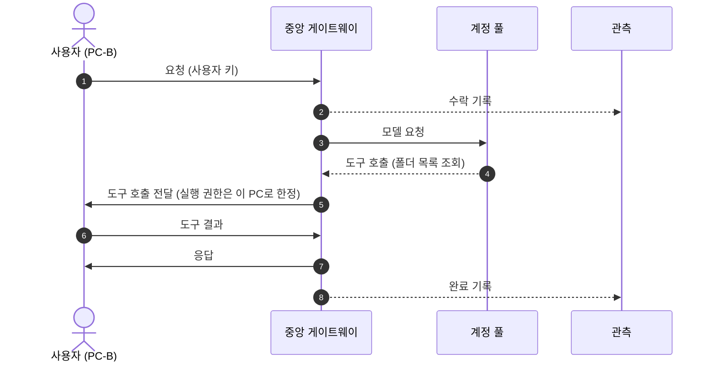
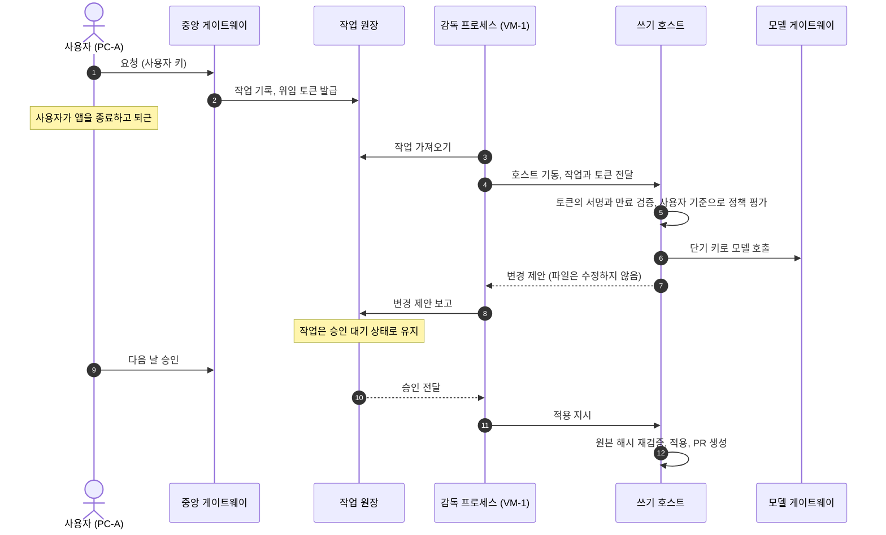
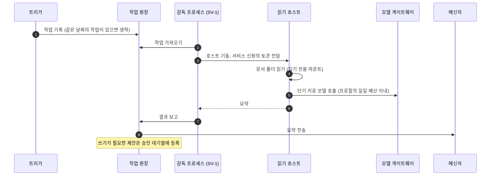
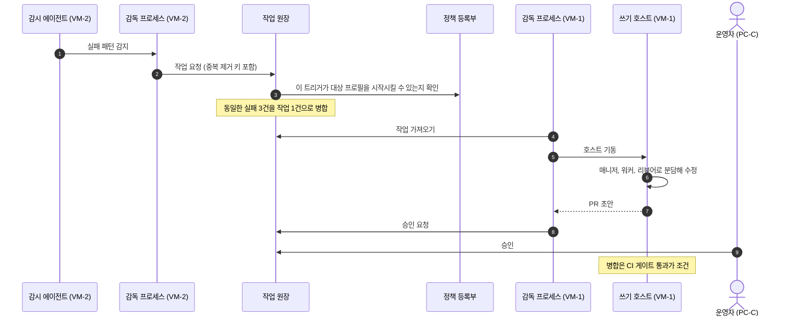

# 유즈케이스

이 구조를 다섯 가지 상황에 대입해 점검합니다. 장비, 인물, 요청 내용은 모두 가상입니다. [인터랙티브 배치도](https://dominic-dk.github.io/harnel/)에서 같은 흐름을 단계별로 볼 수 있습니다.

가상 장비는 7대입니다. PC-A(개발자 노트북), PC-B(현장 담당자 노트북), PC-C(운영자 노트북), 중앙 서버, VM-1(코드 VM), SV-1(문서를 보관하는 사내 서버), VM-2(감시 VM)입니다.

## 1. 내 PC의 폴더 작업

현장 담당자가 PC-B의 데스크톱 앱에 "이번 주 현장 사진 폴더를 날짜별로 정렬하고 목록을 만들어 줘"라고 입력합니다. 파일이 PC-B에만 있으므로 실행도 PC-B에서 이루어집니다.

- **필요한 계층**: 1, 2, 3, 4
- **한계**: PC-B가 실행 주체이므로 앱을 종료하면 작업이 취소됩니다. 사용자가 자리에 없을 때 실행되어야 하는 작업은 다음 유즈케이스의 방식을 사용합니다.

## 2. 퇴근 전 작업 위임

개발자가 퇴근 전에 "정산 금액의 반올림 오류를 수정해 줘"라고 요청하고 실행 위치로 VM-1을 선택합니다. 앱을 종료하고 퇴근합니다.

- **필요한 계층**: 7개 전부
- **검증하는 내용**: 작업의 소유자가 원장이므로 앱을 종료한 뒤에도 작업이 진행됩니다. 승인 권한이 사용자 계정에 연결되어 있어 다른 PC나 메신저에서 승인해도 효과가 같습니다. 호스트는 적용 직전에 파일이 변경 제안 생성 시점과 동일한지 검증합니다.

## 3. 07:00 문서 점검

근무자가 없는 시각에 트리거가 "어제 접수된 공문과 회의록을 요약하고 회신 기한이 있는 항목을 찾는다"는 작업을 생성합니다.

- **필요한 계층**: 2, 3, 4, 5, 6
- **검증하는 내용**: 사용자가 요청한 작업이 아니므로 사용자 권한을 사용하지 않습니다. 트리거의 서비스 신원으로 실행되며, 이 신원은 읽기와 초안 작성만 허용합니다. 쓰기는 제안으로 기록되고, 운영자가 승인한 뒤 별도 작업으로 실행됩니다.

## 4. 빌드 실패 자동 대응

VM-2의 감시 에이전트는 종료되지 않고 빌드 로그를 감시합니다. 같은 테스트가 여러 번 연속으로 실패한 것을 감지합니다.

- **필요한 계층**: 2부터 7까지
- **검증하는 내용**: 감시 장비에는 코드 수정 권한이 없으므로 직접 수정하지 않고 원장을 통해 작업을 요청합니다. 모든 실행이 원장을 거쳐야 인가, 예산, 기록이 적용됩니다. 서비스 신원은 PR 초안 생성까지만 할 수 있습니다.

## 5. 사내 서버 침해

공격자가 SV-1을 장악했다고 가정합니다. 아래 표는 각 시도가 어디서 차단되는지 보여 줍니다.

| 시도 | 차단 지점 | 이유 |
| --- | --- | --- |
| 문서에 삽입한 지시문으로 에이전트가 인증서와 키 파일을 읽게 함 | 에이전트 호스트의 도구 | 경로 허용 여부는 모델이 아니라 도구 코드가 판정합니다. 차단 목록의 파일은 어떤 승인으로도 열 수 없습니다. |
| 모델 계정 탈취 | 모델 게이트웨이 | 장비에는 작업 하나에만 유효한 단기 키만 있습니다. 허용된 모델, 경로, 예산을 벗어난 요청은 거부됩니다. |
| 다른 장비에서 작업을 실행시킴 | 작업 원장 | 실행 장비는 자기 작업을 가져오고 보고하는 것만 할 수 있습니다. 작업 요청은 해당 장비에 등록된 트리거 범위 안에서만 수락됩니다. |
| 정책 파일을 수정해 권한 확대 | 정책 등록부 | 파일을 수정하면 해시가 바뀝니다. 해시가 등록된 값과 다르면 호스트가 정지됩니다. |
| 사용자 PC나 다른 VM에 접속 | 경로 없음 | 모든 장비는 중앙 서버로 가는 아웃바운드 연결만 엽니다. |

- **남는 노출**: SV-1에 마운트된 문서 폴더는 읽힐 수 있고, 일일 예산 한도까지의 모델 사용은 발생할 수 있습니다. 그래서 마운트하는 폴더를 최소로 유지하고 프로필마다 예산을 따로 둡니다.
- **증적**: 거부된 시도는 호스트의 감사 로그, 작업 원장, 관측 서버에 기록되며 함께 검토할 수 있습니다.
